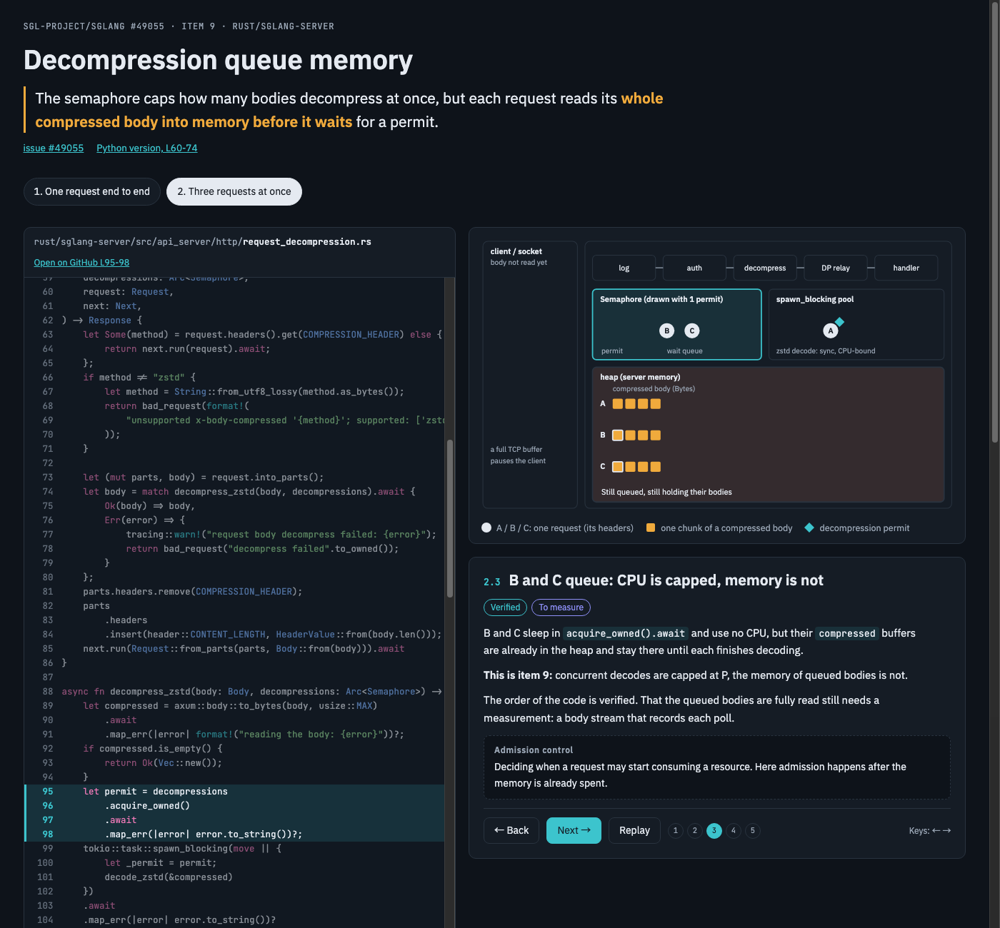

English | [繁體中文](README.zh-TW.md)

# code-walkthrough

An agent skill that builds an interactive walkthrough of a codebase before you change it. Point it at a GitHub issue (or a PR, a bug report, a question) and it follows one concrete traveler, such as a request, a token or a batch, through the real code pinned at a commit, until you can see why the task exists and where it lands.

**[Try the live example](https://liyangtseng.github.io/code-walkthrough/examples/sglang-decompression-queue.html)**: step through it with ← →.



Each page has:

- **A thesis**: one sentence naming the mechanism that makes the task necessary.
- **Pinned source**: every step highlights the lines it explains, at a fixed commit, with a link to them on GitHub.
- **A map**: the traveler moves across the components it crosses, so the thesis is something you watch happen.
- **Evidence tags** on every step: verified, inference, to measure, draft, schematic. You know what you can build on.
- **Concepts taught in passing**: the language or framework idea each step needs, at the moment it needs it.
- **The way forward**: design options, a measurement plan, who else is working on it, and the road to a PR.

## Install

Claude Code, as a plugin:

```
/plugin marketplace add LiyangTseng/code-walkthrough
/plugin install code-walkthrough@code-walkthrough
```

Or clone and link the skill into your personal skills:

```bash
git clone https://github.com/LiyangTseng/code-walkthrough.git
ln -s "$PWD/code-walkthrough/skills/code-walkthrough" ~/.claude/skills/code-walkthrough
```

Other agents that read `SKILL.md` files can use `skills/code-walkthrough/` directly. The build needs `git` and Node.js 18 or later.

## Use

Ask in your own words, in the repository you will work in:

- "Walk me through https://github.com/owner/repo/issues/123 before I implement it."
- "I'm taking this bug next. Build a walkthrough of where it happens."
- "How does a request get from the HTTP layer to the scheduler? Walk me through it."

The agent reads the issue and its discussion, writes the thesis, traces the code at the pinned commit, scripts the steps, draws the map, and builds the page. The build pulls every source file from git at that commit, rejects line ranges and map ids that do not exist, and prints a fact-check list: every step tagged "verified" with the lines it cites, which the agent re-reads before publishing. In Claude's apps the page is published as an artifact; elsewhere you get an HTML file to open in a browser.

Pages come in English or Traditional Chinese labels out of the box, and the narration follows your language.

## Example

[`examples/sglang-decompression-queue`](examples/sglang-decompression-queue) walks through an [sglang](https://github.com/sgl-project/sglang) issue: why queued request decompressions still hold their whole body in memory. [Open it live](https://liyangtseng.github.io/code-walkthrough/examples/sglang-decompression-queue.html), or rebuild it from an sglang checkout:

```bash
node skills/code-walkthrough/scripts/build.mjs examples/sglang-decompression-queue/walk.js --repo ~/path/to/sglang --out docs/examples/sglang-decompression-queue.html
```

GitHub Pages serves `docs/`, so the rebuilt page goes live when it is pushed.

## Layout

```
skills/code-walkthrough/
  SKILL.md              the workflow and the evidence tags
  references/           walk.js format, map design, writing the scenes
  assets/player.html    the player every page is built on
  scripts/build.mjs     pulls pinned sources, checks the walk, writes the page
examples/               walkthroughs to read and copy
```

## License

MIT. The example quotes sglang source, which is Apache-2.0.
