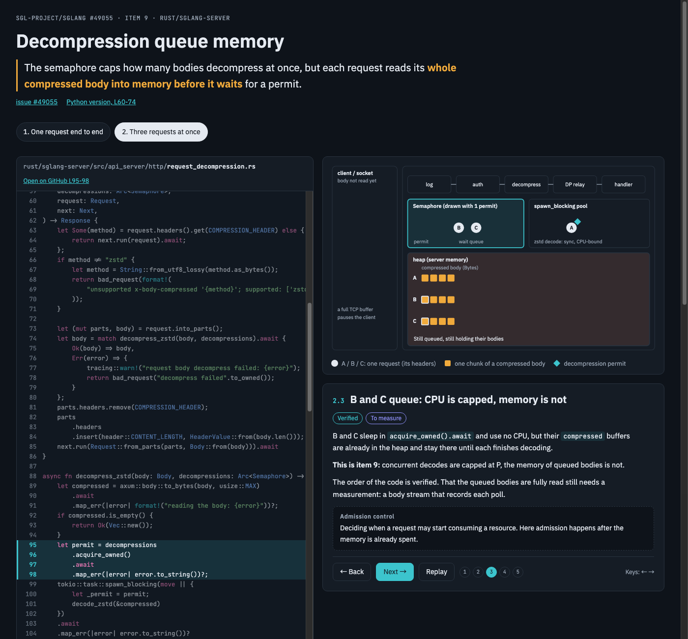

[English](README.md) | 繁體中文

# code-walkthrough

這是一個 agent skill，在你動手改 code 之前，先產生一份互動式的程式碼導覽頁。給它一個 GitHub issue（PR、bug 回報或單純的問題也行），它會挑一個具體的東西，例如一個請求、一個 token 或一個 batch，沿著釘在某個 commit 的真實程式碼走一遍，讓你看清楚這項工作為什麼存在、改動會落在哪裡。

**[線上試用範例](https://liyangtseng.github.io/code-walkthrough/examples/sglang-decompression-queue.html)**：用 ← → 逐步瀏覽。



每一頁都有：

- **一句 thesis**：點出讓這項工作非做不可的機制。
- **釘選版本的原始碼**：每一步都高亮它講的那幾行，版本固定，並附 GitHub 連結。
- **示意圖**：那個請求在各個元件之間移動，thesis 描述的現象會直接在圖上發生。
- **每一步都有可信度標籤**：已查證、推論、待量測、設計草稿、示意圖。你知道哪些可以直接拿來用。
- **用到才教的觀念**：每一步需要的語言或框架觀念，就在那一步講。
- **接下來怎麼走**：設計選項、量測計畫、還有誰在做同一件事，以及到 PR 的路線。

## 安裝

Claude Code 用 plugin 安裝：

```
/plugin marketplace add LiyangTseng/code-walkthrough
/plugin install code-walkthrough@code-walkthrough
```

或 clone 後把 skill 連結到個人 skills 目錄：

```bash
git clone https://github.com/LiyangTseng/code-walkthrough.git
ln -s "$PWD/code-walkthrough/skills/code-walkthrough" ~/.claude/skills/code-walkthrough
```

其他會讀 `SKILL.md` 的 agent 可以直接用 `skills/code-walkthrough/`。建置需要 `git` 和 Node.js 18 以上。

## 使用

在你要動手的 repo 裡，直接用自己的話說：

- 「實作 https://github.com/owner/repo/issues/123 之前，先帶我走一遍。」
- 「下一個要修這個 bug，幫我做一份它發生在哪裡的導覽。」
- 「一個請求怎麼從 HTTP 層走到 scheduler？帶我看一次。」

Agent 會讀 issue 和底下的討論、寫出 thesis、在釘選的 commit 上 trace 程式碼、編排步驟、畫示意圖，最後建置頁面。建置腳本會從 git 取出該 commit 的每個原始檔，擋掉不存在的行範圍和圖上 id，並印出 fact-check 清單：列出每個標為「已查證」的步驟和它引用的行，agent 發布前會逐一重讀。在 Claude 的 app 裡頁面會發布成 artifact；其他環境則產生一個 HTML 檔，用瀏覽器開啟。

介面文字內建英文和繁體中文，說明內容跟著你使用的語言。

## 範例

[`examples/sglang-decompression-queue`](examples/sglang-decompression-queue) 導覽一個 [sglang](https://github.com/sgl-project/sglang) 的 issue：為什麼排隊等解壓的請求，已經把整個 body 讀進記憶體。可以[直接線上看](https://liyangtseng.github.io/code-walkthrough/examples/sglang-decompression-queue.html)，或在 sglang 的 checkout 上重新建置：

```bash
node skills/code-walkthrough/scripts/build.mjs examples/sglang-decompression-queue/walk.js --repo ~/path/to/sglang --out docs/examples/sglang-decompression-queue.html
```

GitHub Pages 會發布 `docs/` 目錄，所以重建後的頁面 push 上去就會更新。

## 授權

MIT。範例引用了 sglang 的原始碼，該專案為 Apache-2.0。
